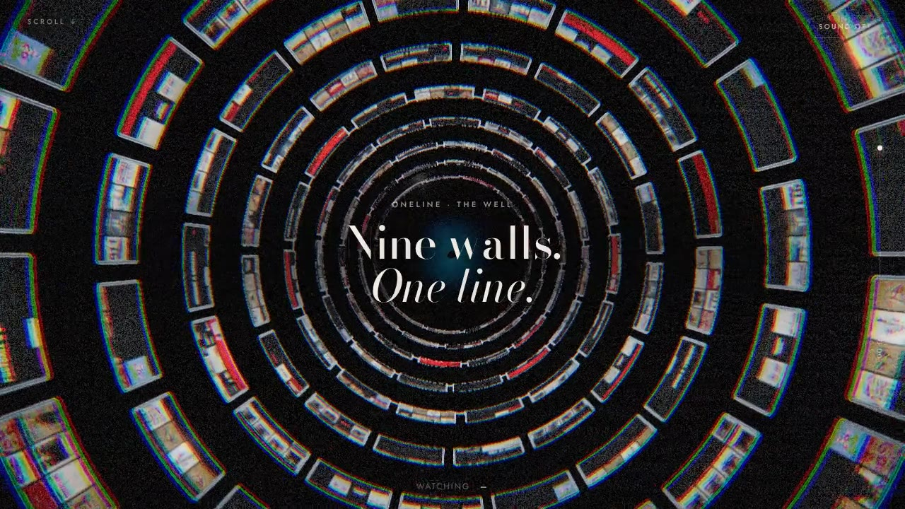
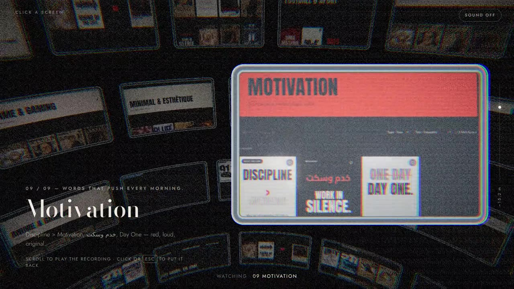
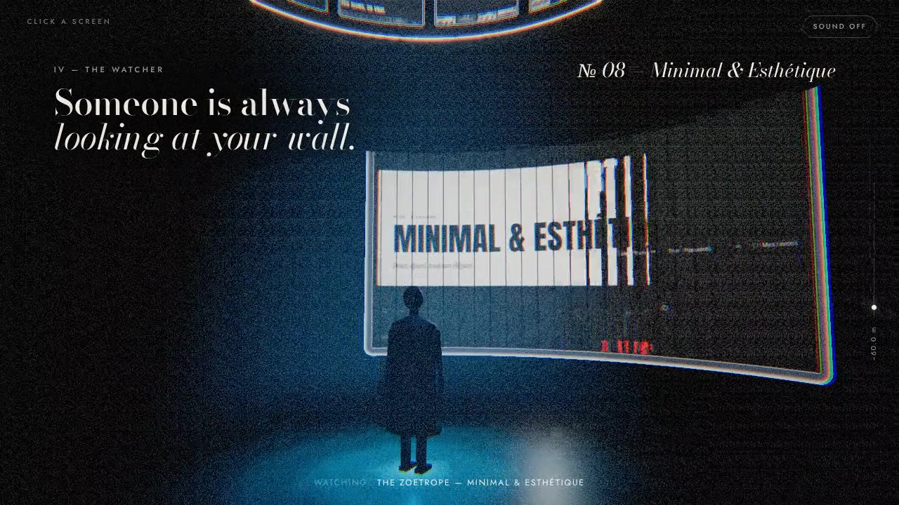
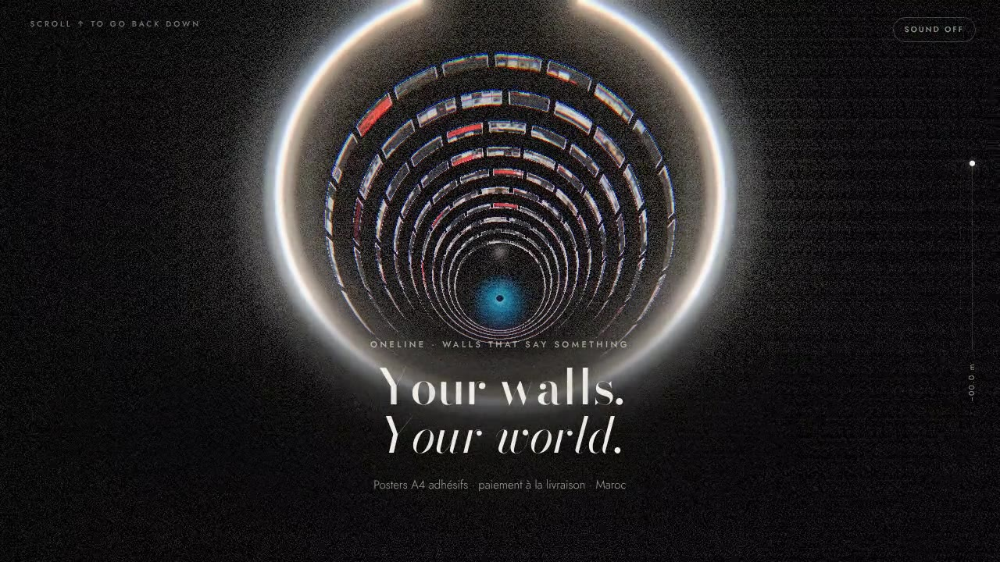

# ONELINE — The Well

A portfolio built as one scroll-driven three.js scene: a dark well lined with rings of curved glass screens.
Each screen plays a top-to-bottom scroll recording of one of nine ONELINE sites (the store home, the shop and
its seven vibes). The rings narrow and turn faster as you go down. At the bottom a lone figure stands in a pool of
Prussian-blue light, watching, while one big screen cranks through the sites like a zoetrope.

## Run

```bash
cd portfolio
npm install
npm run dev        # http://localhost:5173
npm run build      # static site in dist/ (deploy anywhere: Netlify, Vercel, GitHub Pages)
```

## How it behaves

| | |
| --- | --- |
| **Gate** | "Enter with sound" / "Enter quietly". All sound is synthesized live with Web Audio (no files): room tone (brown noise + mains hum through a stone-well convolution reverb), wind that rises with scroll speed, ratchet clatter each time a ring passes a detent, a crank clunk for the zoetrope and for pulling screens. The sound can be toggled at any time. |
| **Scroll** | Scroll position drives the camera down a spiral path. Scroll *speed* drives the rings' turning, the playback of the recordings (scrolling up plays them backwards), the wind, the bloom and a speed-streak lens with chromatic fringing. |
| **Rings** | 10 rings; each is ~10 % narrower and turns ~30 % faster than the one above, alternating direction. |
| **Click a screen** | It leaves the wall, arcs toward you and unrolls flat. Scroll (or swipe) to scrub its recording. Click again or press Esc to put it back. |
| **Bottom** | The figure turns its body, then its head, toward whatever screen is under your pointer (or the centre of the view on touch). You can look up at the rings. The big screen holds a site, then cranks the next one open slit by slit with ratchet clicks. |
| **Finale** | The camera pulls up out of the well until it is a ring of light. "Your walls. Your world." |
| **Type** | Bodoni Moda headlines and Jost body, animated letter by letter. Near-black `#050404`, bone `#f2ede4`, Prussian blue `#003153`, ONELINE red as the only accent. |
| **Accessibility** | `prefers-reduced-motion` slows the rings, disables the streak and simplifies the letter animation. Without WebGL, the page shows the nine sites as a simple list. |

## Walkthrough video

`out/the-well.mp4`: 71 s, 1280×720, 30 fps, with its synthesized soundtrack. It was recorded frame by frame from
the real page with `tools/capture.cjs`, so it shows exactly what a visitor sees: the gate, the descent, a screen
pulled off the wall and unrolled, the watcher and the zoetrope, and the ring-of-light finale.

`dist/` is the ready-to-deploy static build (upload the folder to any static host).






## Files

- `src/world.js`: the well, rings, screens, camera path, the figure, the zoetrope, picking and the unroll.
- `src/screens.js`: curved-glass screen geometry and shaders (scroll playback, bevel, fresnel rim, zoetrope slits).
- `src/post.js`: bloom plus the lens pass (speed streak, chromatic aberration, vignette, grain).
- `src/audio.js`: the sound engine, plus offline rendering for the review video.
- `src/kinetic.js`: letter-by-letter type, driven by the scene clock.
- `src/sites.js`: the nine walls (names, lines, links). Set `STORE_URL` to your live store so "Open the wall" links to it.
- `public/sites/*.jpg`: the scroll recordings (512 px wide strips).

## Tools

```bash
node tools/capture-sites.cjs http://localhost:3100   # re-record the nine walls from the store (../web)
npm run build && npm run preview &                    # then:
node tools/capture.cjs out/the-well.mp4 1280 720 30   # record the scripted walkthrough video with its soundtrack
```

`capture.cjs` drives the page through a deterministic capture API (`?capture=1`), so every frame and every sound
event is reproducible. The soundtrack is rendered with an `OfflineAudioContext` from the same event log.
