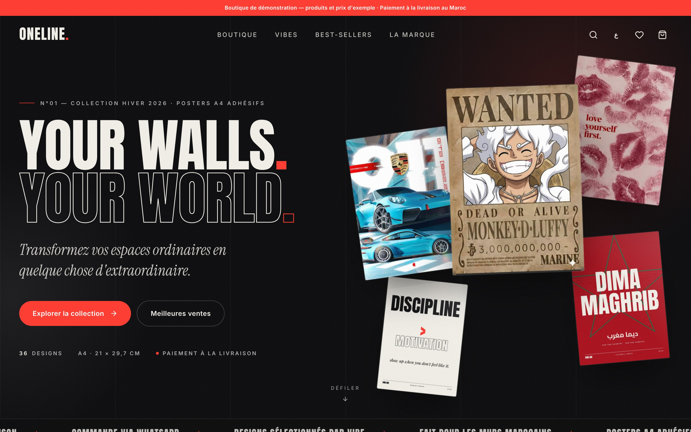
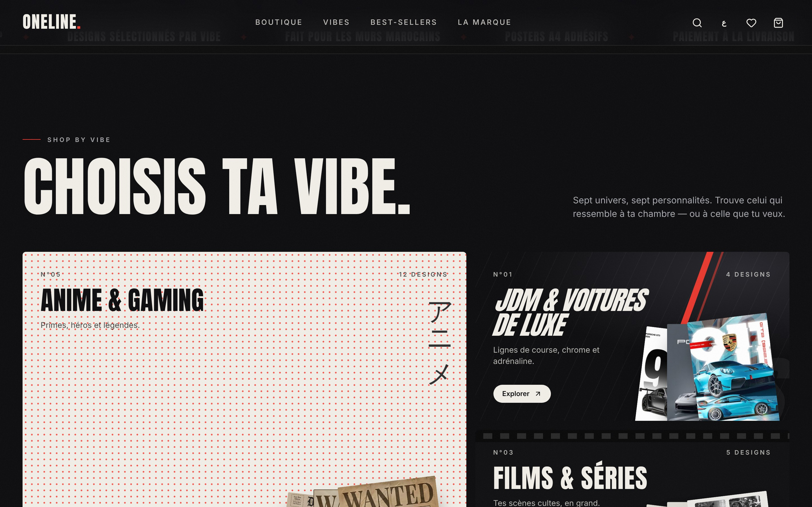
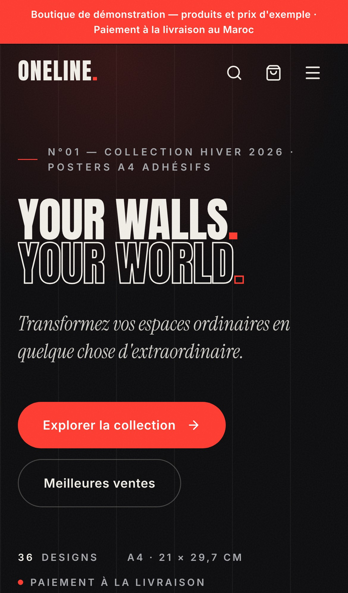

# ONELINE — premium adhesive poster store (Next.js)

Next.js 15 (App Router) · React 19 · TypeScript · Tailwind CSS 4 · Framer Motion · Lucide · Zustand.
French first, Arabic second (full RTL). Prices in MAD. Cash on delivery with WhatsApp order confirmation.

> **Status: working prototype with demo data — not production-ready for real orders yet.**
> Products, prices, delivery fees, phone number and e-mail are placeholders (see `src/lib/config.ts` and `src/lib/products.ts`).
> Orders are not stored on a server: see "Before accepting real orders" below.

## Run it

```bash
cd web
npm install
npm run dev          # http://localhost:3000
npm run build && npm run start   # production build (59 static pages)
```

## What's inside

| Route | What it does |
| --- | --- |
| `/` | Cinematic hero (3D poster wall, parallax, magnetic CTAs), Shop by vibe (7 personalities), featured tabs, before/after room slider, why us, how it works, social proof placeholders, CTA |
| `/shop` | All products — search, vibe chips, type, sort, favourites; state lives in the URL (`?q=&vibe=&type=&sort=&fav=1`) |
| `/collections/[slug]` | One vibe, with its own art-directed header |
| `/product/[slug]` | Gallery with hover zoom, quantity, add to cart, order now, favourites, details/pose/delivery, related, JSON-LD |
| `/cart`, cart drawer | Quantities, removal, free-delivery progress |
| `/checkout` | Name, Moroccan phone validation (06/07/05, +212, 00212), city → delivery fee + ETA, address, note, COD; builds the WhatsApp message |
| `/order?ref=` | Order prepared: **Send on WhatsApp** (wa.me link) / copy message. Never claims the order is confirmed |
| `/track` | Looks up orders prepared on this device and offers a WhatsApp status request |
| `/about`, `/contact`, `/faq`, `/shipping`, `/privacy`, `/terms` | Content pages (legal texts are templates to validate) |

Also: search overlay (⌘/Ctrl + K), quick view, favourites, FR ⇄ AR switch (persists), page transitions,
scroll reveals, adhesive "peel" corner on product cards, film grain, `prefers-reduced-motion` respected everywhere.

## Configure

- `src/lib/config.ts` — **WhatsApp number**, phone, e-mail, socials, free-delivery threshold, delivery zones/fees/ETAs, demo banner (`isDemo`).
- `src/lib/products.ts` — catalogue (name, vibe, price, badge, FR/AR description). Images: `public/products/<slug>.jpg` (A4 ratio, 1000×1414).
- `src/lib/dict.ts` — every UI string in French and Arabic.
- `../tools/prep_web_assets.py` regenerates product images; `../tools/make_room.py` the before/after scene;
  `../tools/make_originals.py` the original ONELINE designs; `../tools/esrgan_upscale.py` AI-upscales artwork.

## Before accepting real orders

1. **Real data**: replace the WhatsApp number, contacts, products, prices and delivery fees; set `isDemo: false`; set `NEXT_PUBLIC_SITE_URL`.
2. **Order backend** — today the order only exists in the customer's browser until they press "Send on WhatsApp".
   Add an API route (e.g. `src/app/api/orders/route.ts`) that validates the cart **server-side** (recompute prices and fees from the database — never trust the client), stores the order and returns the reference.
3. **Database**: Postgres (Supabase / Neon / Vercel Postgres) or a headless commerce/CMS backend for products, stock and orders (`orders`, `order_items`, `customers`, `products`).
4. **WhatsApp**: keep wa.me for simplicity, or use the WhatsApp Business Cloud API to send automatic confirmations from the server.
5. **Admin**: a protected dashboard (or the CMS) to confirm, ship and mark orders delivered — this is what makes `/track` real.
6. **Delivery partner**: connect your carrier (Amana, or a local company) for fees and tracking numbers.
7. **Hosting**: Vercel or Netlify (static pages + serverless API routes), custom domain, HTTPS.
8. **Security & abuse**: server-side validation, rate limiting and a captcha/turnstile on order creation, secrets in environment variables, security headers (CSP), dependency updates.
9. **Legal (Morocco)**: validate CGV and privacy texts, comply with law 09-08 (declare personal data processing to the CNDP if required), add company details (ICE/RC) to the footer.
10. **Content**: replace review and Instagram placeholders with real customer content, and make sure you hold the rights to print and sell every design.
11. **Analytics**: add Meta Pixel / TikTok Pixel / GA4 with a consent banner.

## Quality checks that were run

Production build with type checking; Playwright on desktop (1440×900) and iPhone 13: no horizontal overflow on any page,
cart math (3 × 39 + 39 = 156 MAD), checkout validation (4 field errors, invalid phone rejected), delivery fee by city
(Marrakech 35 → 191 MAD), free delivery from 250 MAD, WhatsApp message content (phone in +212 format, items, fee, total),
cart cleared after preparing the order, tracking lookup, Arabic RTL layout, no console errors.

## Screenshots




